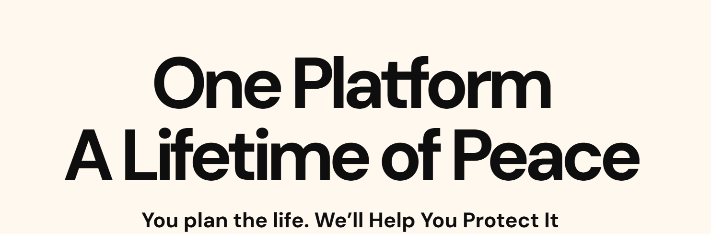

# WillPatra Next

This is a [Next.js](https://nextjs.org/) project bootstrapped with [`create-next-app`](https://github.com/vercel/next.js/tree/canary/packages/create-next-app).

## Getting Started

First, run the development server

```bash
npm run dev
# or
yarn dev
# or
pnpm dev
# or
bun dev
```

Open [http://localhost:3000](http://localhost:3000) with your browser to see the result.

You can start editing the page by modifying `app/page.tsx`. The page auto-updates as you edit the file.

## Scripts

- `npm run dev`: Runs the development server.
- `npm run build`: Builds the application for production.
- `npm run start`: Starts the production server.
- `npm run lint`: Runs ESLint to check for code quality issues.

## Technologies Used

- **Framework**: [Next.js](https://nextjs.org/)
- **Styling**: [Bootstrap](https://getbootstrap.com/), [Framer Motion](https://www.framer.com/motion/)
- **UI Components**:
    - `@vis.gl/react-google-maps`
    - `react-icons`
    - `react-toastify`
    - `swiper`
    - `react-modal-video`
    - `react-countup`
    - `react-countdown`
    - `react-responsive-masonry`
- **Forms**: `react-hook-form`

## File Structure

The project is structured as follows:

### `app/`
The `app` directory contains the application routes and pages, following the Next.js App Router conventions.

- **`(auth)`**: Authentication-related pages (e.g., login, register).
- **`(home-one)`**: Variant 1 of the home page.
- **`(layout-eleven)`**: Layout variant 11 pages.
- **`coming-soon`**: Coming soon page.
- **`fonts`**: Custom font files and configurations.
- **`home`**: Main home page.
- **`multi-page`**: Pages for the multi-page layout version of the site.
- **`one-page`**: Pages for the one-page layout version of the site.
- **`willpatra`**: Project-specific pages.

### `components/`
The `components` directory holds all the React components used throughout the application, organized by feature or page.

- **`animation`**: Components related to animations.
- **`auth`**: Components for authentication forms and flows.
- **`blog-page`**: Components specific to the blog section.
- **`career-page`**: Components for the career/jobs section.
- **`coming-soon-page`**: Components for the coming soon page.
- **`common`**: Reusable components shared across multiple pages (e.g., buttons, inputs).
- **`contact-us-page`**: Components for the contact us page.
- **`faq-page`**: Components for the FAQ section.
- **`home`**: Components used on the home page.
- **`layout`**: Structural components like Header, Footer, and Sidebar.
- **`portfolio`**: Components for displaying portfolio items.
- **`pricing-page`**: Components for pricing tables and sections.
- **`service-page`**: Components for the services section.
- **`team-page`**: Components for displaying team members.

## Learn More

To learn more about Next.js, take a look at the following resources:

- [Next.js Documentation](https://nextjs.org/docs) - learn about Next.js features and API.
- [Learn Next.js](https://nextjs.org/learn) - an interactive Next.js tutorial.

You can check out [the Next.js GitHub repository](https://github.com/vercel/next.js/) - your feedback and contributions are welcome!
